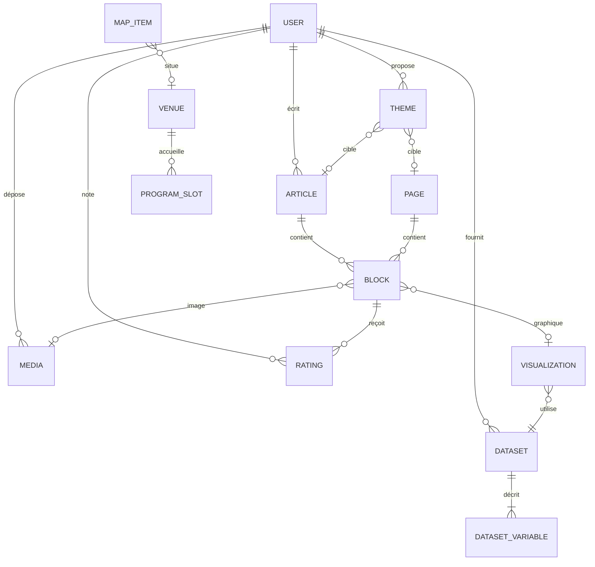

# Architecture d'Evently

## 1. Vue d'ensemble

```
Navigateur ──► nginx :80/443
                 ├── /            → build React (fichiers statiques)
                 ├── /api, /admin → php-fpm (Symfony)
                 └── /uploads     → fichiers déposés (médias, CSV)
php-fpm ──► MySQL 8.4
phpMyAdmin ──► MySQL (dev uniquement)
```

- Une installation d'Evently = **un site d'événement**.
- Le front React est une SPA unique avec deux zones : le **site public** (`/`, `/articles/:slug`, `/programme`, `/plan`, `/billetterie`, pages personnalisées) et l'**admin** (`/admin-app/*`, réservée aux rôles éditoriaux).
- EasyAdmin (`/admin`) est le back-office technique Symfony (super-admin : utilisateurs, réglages, données brutes).
- Authentification par **session Symfony** (cookie `HttpOnly`, `SameSite=Lax`), via `json_login`. Front et API ont la même origine derrière nginx, donc pas de JWT ni de CORS.

### Conteneurs Docker

| Service | Image | Rôle |
| --- | --- | --- |
| `web` | nginx (stable alpine) + build React | Frontal HTTP, fichiers statiques |
| `php` | image maison PHP 8.4-fpm + extensions + code Symfony | API, back-office |
| `db` | mysql:8.4 | Données (volume nommé) |
| `phpmyadmin` | phpmyadmin | Administration de la base (profil `dev`) |
| `node` | node LTS | Serveur Vite en développement uniquement |

Les deux images maison (`web` et `php`) sont publiées sur un registre Docker (exigence du brief). Volumes : `db-data`, `uploads`.

## 2. Modèle de données



| Entité | Champs principaux |
| --- | --- |
| `User` | email (unique), password (haché), displayName, roles[], locale, createdAt |
| `Article` | title, slug, summary, type (`classic` / `dashboard`), status (`draft` / `published` / `hidden`), locale, author → User, coverMedia → Media?, createdAt, updatedAt, publishedAt |
| `Page` | title, slug, template (`blank` / `home` / `contact`), status, menuOrder, showInMenu, locale |
| `Block` | article → Article? **ou** page → Page? (exactement un), position, type (`heading` / `text` / `image` / `visualization`), headingLevel (2–4)?, text?, media → Media?, visualization → Visualization? |
| `Media` | filename, originalName, mimeType, size, width, height, alt (FR/EN), uploadedBy → User, createdAt. Variantes WebP générées à l'upload |
| `Dataset` | name, description, sourceType (`file` / `url` / `api`), sourceUri, delimiter (`;` par défaut), hasHeader, status (`pending` / `validated`), provider → User, rowCount, createdAt |
| `DatasetVariable` | dataset → Dataset, columnIndex, name, label, type (`categorical` / `numerical`), detectedType |
| `Visualization` | title, description (texte alternatif), chartType, dataset → Dataset, mapping (JSON : rôle → nom de variable), colors (JSON), options (JSON : agrégation, tri, bins…), createdBy → User |
| `Rating` | user → User, block → Block, score (0–5), createdAt. Unique (user, block) |
| `Theme` | name, scope (`site` / `page` / `article`), page?, article?, tokens (JSON), status (`proposed` / `approved` / `rejected` / `active`), proposedBy → User, reviewedBy → User?, reviewComment |
| `SiteSettings` | singleton : siteName, tagline, logo → Media?, eventStart, eventEnd, location, defaultLocale, installedAt |
| `Venue` | name, description, color (scène, salle, zone de stand…) |
| `ProgramSlot` | title, description, startsAt, endsAt, venue → Venue?, speakers, category, locale |
| `MapConfig` | singleton : mode (`osm` / `image`), centerLat, centerLng, zoom, backgroundImage → Media? |
| `MapItem` | label, description, kind (`point` / `zone`), geometry (GeoJSON), color, icon, venue → Venue? |
| `TicketOffer` | name, description, price, currency, externalUrl, availability (`available` / `soon` / `sold_out`), position |

Les contenus traduisibles (titres, descriptions) suivent une règle simple : **un enregistrement par langue** (champ `locale`) pour les articles, pages et créneaux ; champs doubles `xxxFr` / `xxxEn` pour les petits libellés (alt, nom d'offre…). À confirmer au sprint concerné.

## 3. Rôles et droits

Hiérarchie Symfony : `ROLE_ADMIN` > tous ; `ROLE_EDITOR` > `ROLE_AUTHOR` > `ROLE_SUBSCRIBER` ; `ROLE_DESIGNER` et `ROLE_DATA_PROVIDER` > `ROLE_SUBSCRIBER`. Un visiteur est anonyme. L'inscription publique crée un abonné ; l'admin attribue les autres rôles.

| Action | Visiteur | Abonné | Auteur | Éditeur | Designer | Fournisseur | Admin |
| --- | :-: | :-: | :-: | :-: | :-: | :-: | :-: |
| Lire le site publié | ✔ | ✔ | ✔ | ✔ | ✔ | ✔ | ✔ |
| Noter un bloc (0–5) |  | ✔ | ✔ | ✔ | ✔ | ✔ | ✔ |
| Créer un article |  |  | ✔ | ✔ |  |  | ✔ |
| Modifier / supprimer ses articles |  |  | ✔ | ✔ |  |  | ✔ |
| Modifier les articles des autres |  |  |  | ✔ |  |  | ✔ |
| Créer une visualisation |  |  | ✔ | ✔ |  |  | ✔ |
| Déposer un média |  |  | ✔ | ✔ | ✔ |  | ✔ |
| Importer / valider un jeu de données |  |  |  |  |  | ✔ | ✔ |
| Proposer un thème |  |  |  |  | ✔ |  | ✔ |
| Approuver / activer un thème |  |  |  |  |  |  | ✔ |
| Pages, programme, plan, billetterie |  |  |  | ✔ |  |  | ✔ |
| Utilisateurs, réglages du site |  |  |  |  |  |  | ✔ |

Chaque ligne est vérifiée par un **voter** Symfony et couverte par un test fonctionnel.

## 4. API (principales routes)

Exposée avec API Platform sous `/api` (documentation OpenAPI sur `/api/docs`).

| Ressource | Routes |
| --- | --- |
| Auth | `POST /api/login`, `POST /api/logout`, `POST /api/register`, `GET /api/me` |
| Installation | `GET /api/install/status`, `POST /api/install` (uniquement si aucun admin n'existe) |
| Articles | `GET /api/articles` (filtres : status, type, locale ; visibilité selon le rôle), `GET/DELETE /api/articles/{id}`, `POST` et `PUT` avec tous les blocs (`ArticleInput`), `GET /api/articles/by-slug/{slug}` (public si publié) |
| Notes | `PUT /api/blocks/{id}/rating` (0 à 5, abonnés, articles publiés), `GET /api/articles/{id}/ratings` (moyenne, nombre et note de l’utilisateur pour chaque bloc, en une requête) |
| Médias | `GET/POST/DELETE /api/media` (multipart) |
| Jeux de données | CRUD `/api/datasets` (création en multipart : `file` ou `url`), `GET /api/datasets/{id}/preview` (50 premières lignes, type détecté et statistiques par colonne), `PUT /api/datasets/{id}/variables`, `POST /api/datasets/{id}/validate`, `GET /api/datasets/{id}/data` (lignes typées, public une fois le jeu validé) |
| Graphiques | `GET /api/chart-types` (matrice de compatibilité), CRUD `/api/visualizations` |
| Thèmes | CRUD `/api/themes` (designers), `POST /api/themes/{id}/approve` et `/reject` (admins), `GET /api/active-themes` (public : thèmes appliqués et leur cible, la cascade est calculée par le front) |
| Pages | CRUD `/api/pages` (éditeurs, `POST`/`PUT` avec tous les blocs), `GET /api/pages/by-slug/{slug}` (public si publiée), `GET /api/menu?locale=fr` |
| Modules | CRUD `/api/venues`, `/api/program-slots`, `/api/map-items`, `/api/ticket-offers`, `GET/PUT /api/map-config` |
| Réglages | `GET/PUT /api/settings` |

## 5. Jeux de données : chargement

1. Le fournisseur dépose un CSV (stocké dans `uploads/datasets/`, hors base) **ou** donne une URL (CSV distant ou API open data).
2. `analyze` lit l'en-tête et les 50 premières lignes, propose un type par variable (numérique si toutes les valeurs non vides sont des nombres, virgule décimale acceptée ; catégorielle sinon) et renvoie un aperçu en tableau.
3. Le fournisseur vérifie le tableau, corrige les types, renomme les libellés, puis **valide**.
4. À l'affichage d'un graphique, `GET /data` relit la source, convertit les valeurs selon les types et renvoie du JSON (cache court, invalidé si la source change).

Garde-fous : taille max du fichier, séparateur `;` (configurable), encodage UTF-8 (détection Windows-1252), URL limitées à `http(s)` et refus des adresses IP privées / locales (SSRF).

## 6. Types de graphiques

Source unique : `ChartTypeRegistry` (back), exposé par `GET /api/chart-types`. Chaque type déclare ses **rôles** de variables, leur type attendu et s'ils sont obligatoires.

| Type | Rôles (type attendu) | Priorité |
| --- | --- | --- |
| `bar` | x (catégorielle), y (numérique, agrégée : somme / moyenne / nombre), série? (catégorielle) | MVP |
| `line` | x (numérique ou catégorielle ordonnée), y (numérique), série? (catégorielle) | MVP |
| `pie` / `donut` | catégorie (catégorielle), valeur (numérique ou comptage) | MVP |
| `histogram` | valeur (numérique), nombre de classes | MVP |
| `scatter` | x (numérique), y (numérique), couleur? (catégorielle), taille? (numérique) | MVP |
| `heatmap` | x (catégorielle), y (catégorielle), valeur (numérique) | Should |
| `treemap` | catégorie (catégorielle), valeur (numérique) | Should |
| `boxplot` | valeur (numérique), groupe? (catégorielle) | Could |
| `sankey` | source (catégorielle), cible (catégorielle), valeur (numérique) | Could |
| `bar3d` | x (catégorielle), y (catégorielle), valeur (numérique), via echarts-gl | Could |

Interactivité attendue sur tous les graphiques : infobulle, légende cliquable (masquer une série), zoom / défilement quand l'axe est continu, mise en surbrillance, export PNG, bascule « voir les données » (tableau accessible).

## 7. Thèmes

Jetons modifiables par un designer (formulaire, aperçu en direct) :

| Jeton | Exemple |
| --- | --- |
| `headerBg`, `headerFg` | couleurs de l’en-tête |
| `pageBg`, `pageFg` | fond et texte global |
| `accent`, `accentFg` | liens, boutons et texte sur l’accent |
| `titleColor`, `titleSize` (1,5 à 3,5 rem) | titres d’articles et de pages |
| `blockBg`, `blockFg`, `blockRadius` (0 à 2 rem) | blocs |
| `fontBody`, `fontHeading` | `system`, `serif`, `rounded` ou `mono` (polices locales, rien n’est téléchargé) |
| `fontSizeBase` | taille de base (14 à 20 px) |
| `chartPalette` | jusqu’à 8 couleurs pour les graphiques sans couleurs propres |

Un thème ne contient que des valeurs vérifiées une à une (classe `ThemeTokens` du back), jamais de CSS libre.

Appliqués comme variables CSS (`--ev-header-bg`, …) sur `<html>` pour la page publique affichée, après résolution article > page > site > design de base ; l’administration garde le design de base. Un seul thème actif par cible : en approuver un archive le précédent. Contraste texte / fond vérifié pendant la saisie (alerte si < AA, 4,5:1).

## 8. Installation « à la WordPress »

Le paquet téléchargeable contient `compose.yaml`, `.env.example` et un `README`. Après `docker compose up -d`, la première visite redirige vers `/installer` : choix de la langue, nom du site, dates et lieu de l'événement, création du compte administrateur, import optionnel de données de démonstration. Une fois un admin créé, l'installeur est désactivé définitivement.
